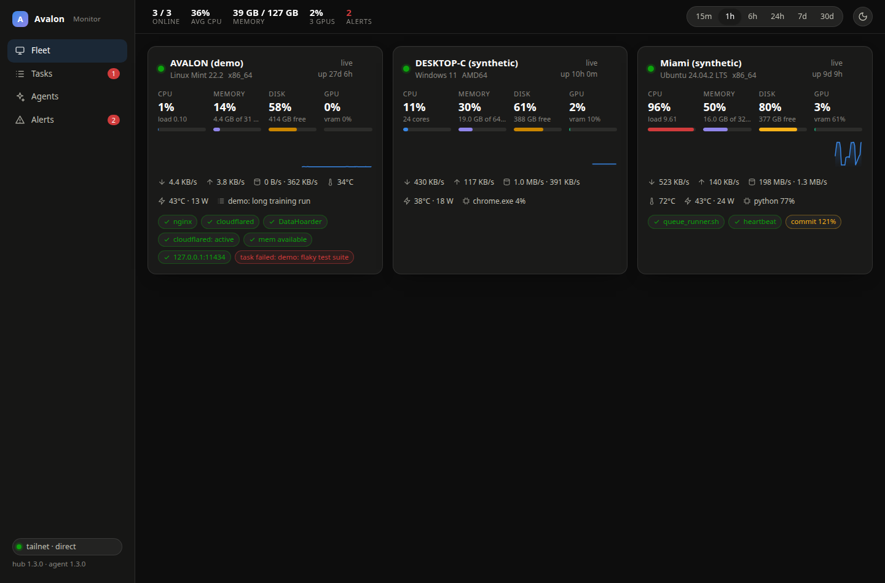
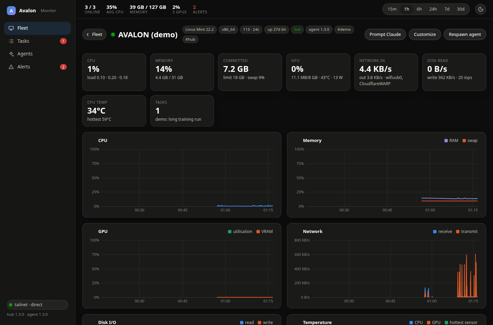
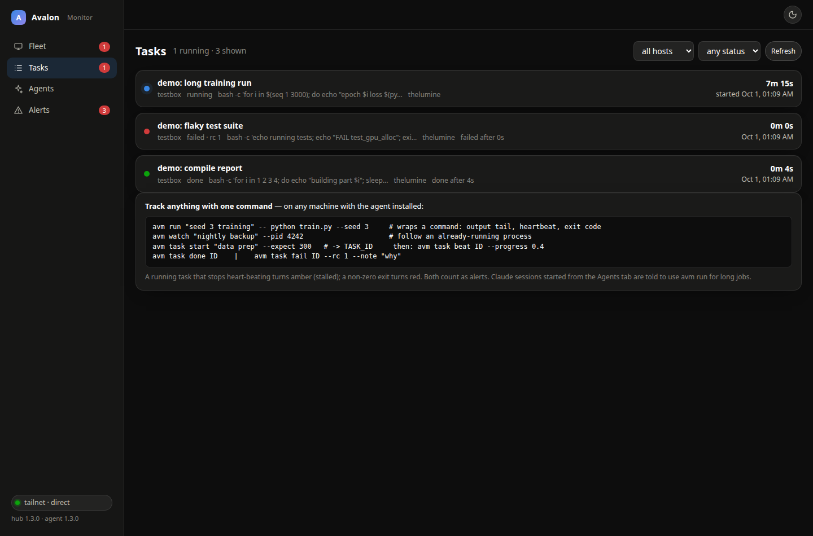
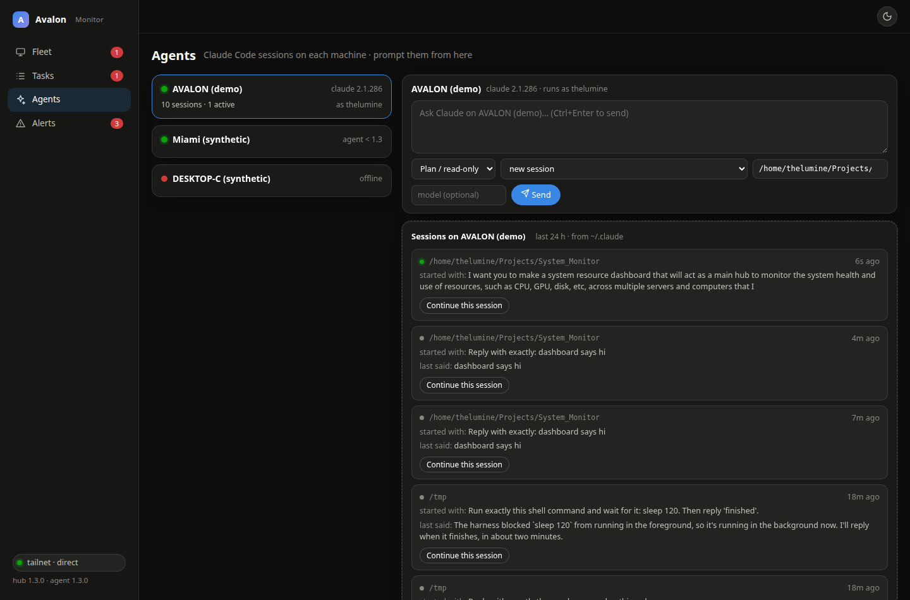

# Avalon Monitor

A self-hosted system-resource hub for the whole fleet — CPU, memory, disks,
disk I/O, network, GPUs, temperatures, top processes and custom liveness checks
from every machine, live on one page.

* **Hub** runs on AVALON (Ubuntu/Mint): FastAPI + SQLite, WebSocket live feed,
  7 days of raw samples + 90 days of 1-minute rollups by default.
* **Agents** are a single Python file that runs on Linux (x86 & ARM/Raspberry Pi),
  Windows and macOS, and push over **Tailscale** with a per-host token.
* **Dashboard** is published at `https://monitor.avalontech.xyz` through the
  existing Cloudflare Tunnel and locked behind **Cloudflare Access**; the hub
  independently verifies the Access token on every request. On the tailnet the
  same dashboard is read-only: every change needs an Access login
  ([docs/SECURITY.md](docs/SECURITY.md)).
* **Agent updates are signed**: agents install only code signed with the
  release key, so the hub alone can't push code to the fleet
  ([docs/RELEASING.md](docs/RELEASING.md)).






```
┌──────────────┐  ┌──────────────┐  ┌──────────────┐  ┌──────────────┐
│ miami (linux)│  │desktop-c (win)│  │ rpi5 (arm64) │  │ laptop (win) │   avalon_agent.py
└──────┬───────┘  └──────┬───────┘  └──────┬───────┘  └──────┬───────┘   (psutil + nvidia-smi /
       └───────── Tailscale ─── POST /api/v1/ingest (bearer token) ──────┘    rocm-smi / sysfs / LHM)
                                        │
                              ┌─────────▼──────────┐
                              │  AVALON  :8787      │  FastAPI · SQLite (WAL) · rollups
                              │  avalon-monitor     │  WebSocket fan-out · Access JWT check
                              └─────────┬──────────┘
                     cloudflared tunnel │ (localhost only)
                              ┌─────────▼──────────┐
                              │  Cloudflare Access │  → https://monitor.avalontech.xyz
                              └────────────────────┘
```

## Repository layout

| Path | What |
|------|------|
| `server/avalon_monitor/` | hub: `main.py` (API/WS), `routes_*.py` (tasks, prompts, checks, results), `checks.py` (check rows, responders), `db.py` (storage), `auth.py` + `core.py` (Access, tokens, Host/Origin guards), `static/` (dashboard) |
| `server/manage.py` | enroll / list / disable / remove hosts, rotate tokens, host checks, respawn, agent versions |
| `agent/avalon_agent.py` | the agent (only dependency: `psutil`) |
| `agent/install/` | `install-linux.sh` (root or `--user`) + systemd unit, `install-windows.ps1` (Scheduled Task) |
| `agent/avm.py` | the `avm` task CLI (installed beside the agent, kept current by auto-update) |
| `agent/*.sig` | release signatures of the agent files (made by `deploy/sign-release.py`) |
| `deploy/deploy-hub.sh` | routine deploy of a pushed commit, no sudo: tests, health check, rollback |
| `deploy/install-server.sh`, `upgrade.sh` | first install / root upgrades (new dependencies, unit changes) |
| `deploy/sign-release.py` | release key and agent signatures |
| `deploy/polkit/` | lets the operator restart the hub service without sudo (used by deploy-hub.sh) |
| `deploy/backup/` | nightly restic backup that reports to the host's Backups card |
| `deploy/` (rest) | hub systemd unit, cloudflared ingress snippet |
| `tests/` | `tests/run.sh`: the whole suite, run by deploy-hub.sh before every deploy |
| `docs/CLOUDFLARE.md` | step-by-step tunnel + Access setup |
| `docs/SECURITY.md` | who may view / change what, request guards, agent local policy, threat model |
| `docs/RELEASING.md` | versions, tests, signing, deploying |
| `docs/HOSTS.md` | ready-to-paste `agent.conf` per machine (Miami, DESKTOP-C, AVALON, Pi), backups, data-use-agreement hosts |

## What's on the dashboard

| Tab | What it shows |
|-----|---------------|
| **Fleet** | one card per machine (CPU/mem/disk/GPU meters, sparkline, checks, running tasks); click for the full host page with charts, tables and the checks editor. Drag cards by their handle to reorder; on a host page, **Customize** lets you drag panels around and hide the ones you don't need — per host or for all hosts. Layouts are saved to your user on the hub, so they follow you across browsers. |
| **Tasks** | everything reported through the `avm` command: live status, elapsed time, heartbeat, exit code, last output lines. Failed → red, stalled (no heartbeat) → amber, host gone → lost. A failed/stalled/lost task alerts (Alerts tab, sidebar badges, host-card chip) until you open it or dismiss it, or for `AVM_TASK_ALERT_HOURS` (default 24, `0` = never expire) after it happened; acknowledged tasks stay in the list and a later failure alerts again. |
| **Agents** | Claude Code sessions on each machine (from `~/.claude/projects`: what each was started with, what it last said, how long ago) and a prompt console: pick a permission mode, a working directory, optionally a session to continue, and send. Output streams back live; follow-ups resume the same session. |
| **Research** | per-project results pages fed by `avm results push`: headline table (value dot + 95 % CI whisker, chance line, comparator tick, change vs the previous push, history sparkline), a must-read notes panel, programme status chips, and generic bar / distribution figures. Every push is kept; pick an earlier one from the menu. Updates live when a new push lands. |
| **Alerts** | one list of what needs attention: offline hosts, failing checks, the GPU-stall rule, agent update errors, failed/stalled/lost tasks, failed prompts. Clicking goes to the source. |

Opened from the tailnet or localhost, the dashboard is read-only: the hub refuses every change from there (prompts,
check edits, restarts, dismissing alerts). Changes go through `AVM_PUBLIC_URL` with a Cloudflare Access login.

### `avm` — one command when you set something off

Installed on every machine next to the agent (`/usr/local/bin/avm`, `~/.local/bin/avm`
for rootless installs, `C:\ProgramData\AvalonAgent\avm.cmd` on Windows):

```bash
avm run "seed 3 training" -- python train.py --seed 3   # wraps a command: output tail, heartbeat, exit code
avm watch "nightly backup" --pid 4242                   # follow an already-running process
avm task start "data prep" --expect 300                 # manual lifecycle -> prints TASK_ID
avm task beat ID --progress 0.4 --log "epoch 3"
avm task done ID        |   avm task fail ID --rc 1 --note "why"
avm task list
avm results push myproject docs/results/dashboard.json      # publish a results document to the Research tab
```

* `avm run` always runs the command. If the hub is down, rejects the token or there is no config, it prints
  `avm: untracked: <reason>` and runs it untracked. The exit code is passed through (killed by a signal: 128+n).
* A task shows **stalled** after 3× `--beat` (default 30 s) without a heartbeat; `avm task start --expect N`:
  after 1.5× N.
* **Task logs stay local where they must.** `AVM_TASK_LOG=off` in `agent.conf` stops output lines from leaving the
  host, and the command line and working directory too (name, status, exit code, timing and note still go).
  `AVM_TASK_LOG_OFF_DIRS=<dir>,...` does the same for runs started inside those directories. `avm run --no-log` /
  `--log` force it per run. The hub can't change any of these. See
  [docs/HOSTS.md → data-use agreements](docs/HOSTS.md#hosts-with-data-use-agreements).

**Resources and the wait queue** (host-local, opt-in):

```bash
avm run "nymeria b4020" --gpu --exclusive --mem 19G --wait --max-wait 8h -- python train.py
avm queue status          # what is running / waiting on this host
avm queue drain --wait    # admit nothing new, return once the host is idle (e.g. before a git pull)
avm queue resume
```

`--exclusive` means one heavy GPU job at a time: it waits only for another `--exclusive` job. A light `--gpu` job is
**not** held back by a running exclusive one and may share the GPU with it. Give it `--vram 6G` so it is admitted
only when that much VRAM is measured free (minus what jobs still starting have declared). `--mem` works the same for
RAM. `--wait` queues until the job fits (first come, first served among jobs competing for the same resource).
Without `--wait` the tags only declare.

The queue lives in a directory shared by all users of the host: `/run/avm-queue` if it exists, else
`/tmp/avm-queue` (Windows: `%ProgramData%\AvalonAgent\queue`; `AVM_QUEUE_DIR` overrides). avm never puts a ticket
in a queue dir that is a symlink, isn't owned by root or you, or is writable by others without the sticky bit (the
same rules for its parents), and it never follows symlinks inside it. Such a dir never stops a job, though: `avm run`
prints `queue disabled: <why>; running without admission control`, notes it on the task and runs the command at
once, exit code passed through as usual (`avm queue status/drain/resume` report the error). On a multi-user host
`/tmp/avm-queue` belongs to whoever queued first after a boot, so everyone else's jobs run unqueued. The fix is a
root-owned `/run/avm-queue`: the root `install-linux.sh` creates it (a tmpfiles.d entry, so it comes back at every
boot). For a host with only `--user` installs, once:

```bash
echo 'd /run/avm-queue 1777 root root -' | sudo tee /etc/tmpfiles.d/avm-queue.conf && sudo systemd-tmpfiles --create
```

**Results documents** (`POST /api/v1/projects/<project>/results`, host token, tailnet only) are
JSON objects with `schema: "<name>-results/<n>"`, `project` equal to the URL slug, and any of
`headline` (rows: `id`, `group`, `result`, `metric`, `n`, `value`, `ci: [lo, hi] | null`, `chance`,
`comparator: {label, value}`, `compliance`, optional `scale: [lo, hi]`), `programmes` (`title`,
`status`: running / closed / fail / partial / registered / reference, `status_text`, `key_result`,
`registration`, `updated`, `eta`), `bars` (`title`, `unit`, optional `domain`, `better`, `rows` of
`label` / `value` / `ci`), `distributions` (`title`, `series` of `label` / `values`, optional
`point_labels` to join one unit across series) and `notes` (strings). Keep headline `id`s stable:
history is keyed on them. The hub renders only what is pushed and never reads the project itself,
so a feed must carry aggregates only.

Claude sessions launched from the Agents tab are told (via system prompt) to wrap
long-running work in `avm run`, so their training runs show up as tasks.

### Prompting Claude from the dashboard — what it can do

A prompt becomes a job queued for that host; the agent runs `claude -p` **as the
user the agent runs as**, in the chosen directory, and streams the session back.
Permission modes: *Plan / read-only* (default), *Accept edits*, or *Full access*
(`--dangerously-skip-permissions`; asks for confirmation and is logged with your
identity).

Two gates, one on each side:

* **Hub:** queueing a prompt (or restarting/stopping a session) needs a Cloudflare Access login, and a place on
  `AVM_OPERATORS` when that list is set. Tailnet viewers can't.
* **Host:** each agent caps what it accepts in its own `agent.conf`, which the hub can't override.
  `AVM_MAX_JOB_MODE` defaults to `plan`, so *Accept edits* and *Full access* are refused until a host raises it.
  `AVM_ALLOW_ACTIONS=false` blocks session restart/stop, and an agent running as root/SYSTEM refuses all prompts
  unless `AVM_ALLOW_ROOT_JOBS=true`. `AVM_JOB_TRANSCRIPT=summary|off` limits what the transcript sends back
  (and, unless `AVM_SESSION_SNIPPETS` says otherwise, the session snippets in each report). A restart that resumes
  a session runs it at the host's own cap, whatever mode it was started with, and only on sessions the host itself
  lists. The hub refuses prompts and restarts to agents that report no policy (older than 1.9) and anything above
  a host's reported limit.

Prompting needs the agent to run as a user with a Claude login: the rootless `--user` install on Linux, or
`install-windows.ps1 -AsCurrentUser` on Windows. Set `AVM_CLAUDE=false` in an agent's config to opt a machine out
entirely. Details: [docs/SECURITY.md](docs/SECURITY.md#agent-local-policy).

## 1. Install the hub on AVALON

```bash
git clone <this repo> ~/Projects/avalon-monitor && cd ~/Projects/avalon-monitor
sudo ./deploy/install-server.sh
```

That creates the `avalon-monitor` system user, a venv in `/opt/avalon-monitor`,
the DB in `/var/lib/avalon-monitor`, config in `/etc/avalon-monitor/monitor.env`
(every setting: [`server/.env.example`](server/.env.example)), and starts
`avalon-monitor.service`. The dashboard is immediately reachable on the tailnet
at `http://<avalon-tailscale-ip>:8787/`, read-only and without a login;
everything else is refused. Changing anything (prompts, checks, dismissing
alerts) needs the Cloudflare Access login from step 3.

Upgrades after that: `deploy/deploy-hub.sh main` (no sudo; ships only pushed
commits, runs the tests, health-checks and rolls back), or
`sudo ./deploy/upgrade.sh` when a release changes dependencies or the unit.
`upgrade.sh` runs `install-server.sh`, which copies the **working tree** as it
is (uncommitted files included) with no tests, health check or rollback: run it
from a clean checkout of a pushed commit. See [docs/RELEASING.md](docs/RELEASING.md).

### Run from the checkout instead (development)

```bash
python3 -m venv .venv && .venv/bin/pip install -r server/requirements.txt -r agent/requirements.txt -c tests/constraints-prod.txt pytest httpx
cp server/.env.example server/.env    # edit: AVM_DB_PATH=data/monitor.db is fine here
cd server
../.venv/bin/python manage.py add-host avalon
../.venv/bin/python -m avalon_monitor.main
```

The same `.venv` runs the test suite (`tests/run.sh`) and the deploy gate.

## 2. Enroll a machine and install its agent

On AVALON, one command per machine (the token is shown once):

```bash
avalon-monitor-manage add-host miami --display "Miami" --notes "RTX 4060 Ti training box"
```

Then on the machine — copy the `agent/` folder over (scp, git, USB…) and:

**Linux / Raspberry Pi**

```bash
./install/install-linux.sh --user --server http://avalon:8787 --token avm_…   # rootless (needed for prompts)
sudo ./install/install-linux.sh --server http://avalon:8787 --token avm_…     # or: root system unit
# later: the same with --upgrade
```

**Windows** (elevated PowerShell)

```powershell
Set-ExecutionPolicy -Scope Process Bypass
.\install\install-windows.ps1 -Server http://avalon:8787 -Token avm_…                  # runs as SYSTEM
.\install\install-windows.ps1 -Server http://avalon:8787 -Token avm_… -AsCurrentUser   # runs as you (needed for prompts)
```

A root / SYSTEM agent reports everything but refuses dashboard prompts and session restart/stop
(`AVM_ALLOW_ROOT_JOBS`, see [docs/SECURITY.md](docs/SECURITY.md#agent-local-policy)).

`http://avalon:8787` works when MagicDNS is on; otherwise use the tailnet IP
(`http://100.x.y.z:8787`). The agent never talks to the public hostname. Any
other name for AVALON must be on the hub's Host allowlist (`AVM_ALLOWED_HOSTS`).

**AVALON itself** runs its agent rootless, as the operator:
`./agent/install/install-linux.sh --user --server http://127.0.0.1:8787 --token … --name avalon`
(config in `~/.config/avalon-agent/agent.conf`; see [docs/HOSTS.md](docs/HOSTS.md#avalon-this-hub--configavalon-agentagentconf)).

### Agent options (`agent.conf`)

`~/.config/avalon-agent/agent.conf` (rootless), `/etc/avalon-agent/agent.conf` (root) or
`%ProgramData%\AvalonAgent\agent.conf`. Every key with its default is in
[`agent/agent.conf.example`](agent/agent.conf.example). Put comments on their own line: text after a value becomes
part of the value.

```ini
# seconds between samples; top-N processes by CPU; chips on the host page
AVM_INTERVAL=5
AVM_PROCESSES=8
AVM_TAGS=gpu,training
# checks: process alive (name or cmdline substring); file touched within N s; port open; volume mounted
AVM_WATCH_PROCESSES=queue_runner.sh
AVM_WATCH_FILES=/srv/queue/heartbeat:120
AVM_WATCH_TCP=127.0.0.1:11434
AVM_WATCH_MOUNTS=/run/media/<user>/Data
# show a file's first line (e.g. the running job); globs that must match nothing (or glob::regex on content)
AVM_WATCH_CONTENT=/srv/queue/current.txt
AVM_WATCH_MARKERS=~/markers/*.done::rc=(?!0\b)
# warn when a queue file is empty; systemd unit state (system: | user: | user@NAME:)
AVM_WATCH_NONEMPTY=/srv/queue/queue.txt
AVM_WATCH_UNITS=user:train-queue.service
# active scopes = "a job is running" (drives the GPU-stall rule); amber when MemAvailable drops below N GB
AVM_WATCH_JOBS=user:train-*.scope
AVM_MEM_AVAILABLE_WARN_GB=8
# Windows: LibreHardwareMonitor for temps / AMD-Intel GPUs
AVM_LHM_URL=http://localhost:8085/data.json
```

Checks show up as green/red (or amber for warnings) chips on the fleet card
and count toward the "alerts" figure in the header. The hub adds one derived
check of its own: **gpu stalled** fires when a host has had a job scope active
for `AVM_RULE_GPU_STALL_MINUTES` (10) while GPU utilisation never exceeded
`AVM_RULE_GPU_STALL_PERCENT` (5) — the "healthy-looking 30× slowdown" case — handy for "is the queue runner still alive"
style questions that raw CPU/GPU numbers don't answer.

GPU sources, in order: `nvidia-smi` (Linux & Windows), amdgpu `sysfs`
(Linux, no ROCm needed; falls back to `rocm-smi` when the card is power-gated),
LibreHardwareMonitor (Windows). Because a job can be data-loader-bound while the
GPU idles, the host page shows per-process CPU right beside GPU utilisation,
and the fleet card shows the busiest process.

### Checks: the hub is the source of truth

On an agent's first report with checks (agent 1.7+), the hub **adopts** its `AVM_WATCH_*` /
`AVM_MEM_AVAILABLE_WARN_GB` entries as check rows. From then on it sends every list in each reply (empty ones too),
so editing those lines in `agent.conf` has no effect. Change checks on the host page (**Checks**), with
`avm check add/set/rm` on the host, or from AVALON:

```bash
avalon-monitor-manage checks miami                                    # show the host's remote settings
avalon-monitor-manage checks miami --set AVM_WATCH_TCP=127.0.0.1:11434 # only the keys given change
avalon-monitor-manage checks miami --clear                            # remove every check and remote setting
```

`PUT /api/v1/hosts/{name}/checks` behaves the same: only the keys in the body change. An `AVM_WATCH_*` key replaces
that kind's rows (entries that stay keep their labels, responders and state), other kinds and settings are untouched,
and a hub-managed host stays managed. After `--clear`, a managed host runs no `AVM_WATCH_*` checks; it doesn't fall
back to `agent.conf`. Agents keep the last settings in `remote-config.json` (beside their config, or `AVM_STATE_DIR`),
so hub-added checks are there from the first sample after a restart.

**Responders.** A check can name a Claude session to alert when it goes from ok to failing (`avm check add …
--notify self|new`, or a tracked agent on the Checks panel). The alert is a read-only (plan-mode) prompt with paths,
ids and exit codes, never file contents (`--with-log` adds avm task log tails). Guardrails:

* a cooldown per check (default 30 min, at least 5) and a cap per **rolling 24 h** (`--daily-cap`, default 6);
* one open alert per check until it recovers;
* an alert that can't go out yet (cooldown or cap reached, the target session mid-turn, no usable Claude on the host)
  is **held** and goes out on a later report if the check is still failing; it isn't dropped;
* a report without the check (`unknown`, e.g. right after an agent restart) doesn't reset it. A check that was ok,
  went unknown and comes back failing alerts like ok → failing, and a failure's start time survives the gap;
* a live, idle target is sent a fork of its session when the agent supports it, otherwise a fresh read-only session
  in its working directory. A live session is never written into.

### Upgrading and releases

Routine releases: `deploy/deploy-hub.sh main` on AVALON. No sudo. It ships only commits on `origin/main`, refuses a
downgrade unless `--force`, runs `tests/run.sh` on the exact commit, health-checks and smoke-tests the restarted hub,
rolls back on failure, and only then puts `agent/` in place for the fleet. Releases that change dependencies or the
systemd unit: `sudo ./deploy/upgrade.sh` (`--rootless-agent` also moves AVALON's own agent to a user service).
Signing, the test suite and the details: **[docs/RELEASING.md](docs/RELEASING.md)**.

### Agents update themselves

Agents compare the SHA-256 of their own script with the one the hub serves in every report reply. When it differs,
each agent downloads the new `avalon_agent.py` on its next report, checks the hash, the **release signature**
(agents 1.9+: an Ed25519 key built into the agent, which the hub can't change) and that it compiles, then replaces
itself atomically and re-execs. `avm.py` follows the same way. The whole fleet converges within one interval, with no
per-machine steps and no inbound ports. Unsigned or wrongly signed code is never installed; the host card shows why.
Check with `avalon-monitor-manage agents`; pause fleet-wide with `AVM_AGENT_AUTO_UPDATE=false` on the hub or per
host with `AVM_AUTO_UPDATE=false` in its `agent.conf`. The download uses the same token and tailnet-only rules as
ingest (Tailscale encrypts the hop).

A **Respawn agent** button (host page) re-execs an agent in place; it rides the same reply channel as checks.

## 3. Publish it at `monitor.avalontech.xyz`

Follow [docs/CLOUDFLARE.md](docs/CLOUDFLARE.md): one ingress rule in
`/etc/cloudflared/config.yml`, one Access application, three lines in
`monitor.env`. Until Access is configured the hub refuses anything arriving
through the tunnel, so the order of those steps doesn't matter.

## API

Every route the hub registers (`main.py`, `routes_ops.py`, `routes_checks.py`, `routes_results.py`). Paths are under
`/api/v1` unless they start with `/`. Every request must also pass the Host allowlist. Auth:

* **viewer**: a Cloudflare Access JWT, or a direct request from a trusted network (tailnet, localhost). Read-only.
* **operator**: an Access identity (on `AVM_OPERATORS` when set; trusted networks only with `AVM_TRUSTED_WRITE=true`),
  plus `X-Requested-With: avalon-monitor` and a same-origin `Origin` / `Sec-Fetch-Site`.
* **agent**: `Authorization: Bearer avm_…` (the host's token), from `AVM_INGEST_NETWORKS`, never through Cloudflare;
  acts on its own host only.
* **none**: no auth.

| Method | Path | Auth | What |
|--------|------|------|------|
| `GET` | `/healthz` | none | `{"ok": true, "version": …}`, no DB access |
| `GET` | `/static/…` | none | dashboard JS/CSS |
| `GET` | `/` | viewer | dashboard page |
| `WS` | `/live` | viewer + same-origin | snapshot on connect, then `host` / `task` / `check` / `claude_job` / … messages |
| `GET` | `/config` | viewer | version, your identity, `can_change`, public URL, ranges, metrics |
| `GET` | `/hosts` | viewer | fleet list with per-host summaries and online status |
| `GET` | `/hosts/{name}` | viewer | latest full sample + remote settings |
| `GET` | `/hosts/{name}/series?metrics=cpu,mem&range=6h&points=600` | viewer | bucketed history (`15m…30d`) |
| `GET` | `/hosts/{name}/checks` | viewer | the host's remote settings and the remotely settable keys |
| `PUT` | `/hosts/{name}/checks` | operator | change remote settings; only the keys in the body change |
| `GET` | `/hosts/{name}/checklist` | viewer | the Checks panel: rows with live results, rule checks, responder targets |
| `POST` | `/hosts/{name}/checklist` | operator | add a check row |
| `PATCH`, `DELETE` | `/checklist/{id}` | operator | edit / remove a check row |
| `PUT` | `/hosts/{name}/check-settings` | operator | `AVM_COMMIT_WARN_PCT`, `AVM_TAILSCALE_MIN`, `AVM_PROCESSES`, `AVM_TAGS` |
| `POST` | `/hosts/{name}/command/respawn` | operator | re-exec the agent on its next report |
| `GET` | `/stats` | viewer | row counts, DB size |
| `GET` | `/agent` | viewer | served agent version vs each host's |
| `GET` | `/tasks?host=&status=&limit=`, `/tasks/{id}` | viewer | tasks for the dashboard |
| `POST` | `/tasks/ack` | operator | acknowledge (or `undo`) failed / stalled / lost tasks |
| `DELETE` | `/tasks/{id}` | operator | delete a task |
| `GET` | `/claude/jobs?host=&limit=`, `/claude/jobs/{id}?after=` | viewer | prompts and their transcript events |
| `POST` | `/claude/jobs` | operator | queue a prompt (`mode: full` needs `confirm_full: true`; the host's `AVM_MAX_JOB_MODE` still applies) |
| `POST` | `/claude/jobs/ack` | operator | acknowledge (or `undo`) failed prompts |
| `POST` | `/claude/jobs/{id}/cancel` | operator | cancel a queued or running prompt |
| `GET` | `/claude/tracked?host=` | viewer | tracked Claude sessions |
| `POST` | `/claude/tracked` | operator | track a session |
| `DELETE` | `/claude/tracked/{id}` | operator | untrack |
| `POST` | `/claude/tracked/{id}/action` | operator | `restart` / `stop` a tracked session |
| `GET` | `/projects`, `/projects/{p}/results?push=`, `/projects/{p}/results/history` | viewer | Research tab |
| `GET`, `PUT` | `/prefs` | viewer (`PUT`: + `X-Requested-With`, same-origin) | per-user layout preferences (all trusted-network viewers share one) |
| `POST` | `/ingest` | agent | a sample; the reply carries remote settings, commands, prompts and the update offer |
| `GET` | `/agent/script`, `/agent/file/avm.py` | agent | self-update downloads (installed only if signed) |
| `POST` | `/tasks`, `/tasks/{id}/beat`, `/tasks/{id}/finish` | agent | task lifecycle (what `avm` calls) |
| `GET` | `/tasks/mine?status=` | agent | this host's tasks (`avm task list`) |
| `GET`, `POST` | `/agent/checks` | agent | `avm check list` / `add` |
| `PATCH`, `DELETE` | `/agent/checks/{id}` | agent | `avm check set` / `rm` |
| `POST` | `/agent/claude/track`, `/agent/claude/untrack` · `GET /agent/claude/tracked` | agent | `avm agent track` / `untrack` / `list` |
| `POST` | `/claude/jobs/{id}/start`, `/claude/jobs/{id}/events`, `/claude/jobs/{id}/finish` | agent | prompt progress from the host running it |
| `POST` | `/projects/{p}/results` | agent | `avm results push` |

Metrics: `cpu load1 cpu_temp mem swap disk_read disk_write net_rx net_tx gpu_util gpu_mem gpu_temp temp_max disk_used`.

## Operations

```bash
avalon-monitor-manage list-hosts            # last-seen, source IP
avalon-monitor-manage rotate-token miami    # then update that agent's config
avalon-monitor-manage disable laptop-c      # keep history, refuse pushes
avalon-monitor-manage checks miami [--set KEY=VALUE ...] [--clear]
avalon-monitor-manage respawn miami         # or: respawn all
avalon-monitor-manage agents                # served agent vs each host, self-update errors
avalon-monitor-manage stats                 # row counts, DB size
deploy/deploy-hub.sh --status               # deployed version and commit
journalctl -u avalon-monitor -f
```

Every hub setting, with its default, is in [`server/.env.example`](server/.env.example). Retention is tunable with
`AVM_RETENTION_RAW_HOURS` / `AVM_RETENTION_1M_DAYS`; a host is shown offline after `AVM_OFFLINE_AFTER_SEC` (30 s)
without a sample. The DB is a single file (`/var/lib/avalon-monitor/monitor.db`). Back it up with
`sqlite3 monitor.db ".backup /path/backup.db"`; AVALON's nightly restic backup does this
(`deploy/backup/avalon.json`).

**Backups** of any host show on its Backups card: `sudo deploy/backup/install-restic-backup.sh deploy/backup/<host>.json`
sets up a nightly restic run that reports `ok` / `partial` / `failed` / `running`. See
[docs/HOSTS.md → Backups](docs/HOSTS.md#backups-backups-card-agent-18).
